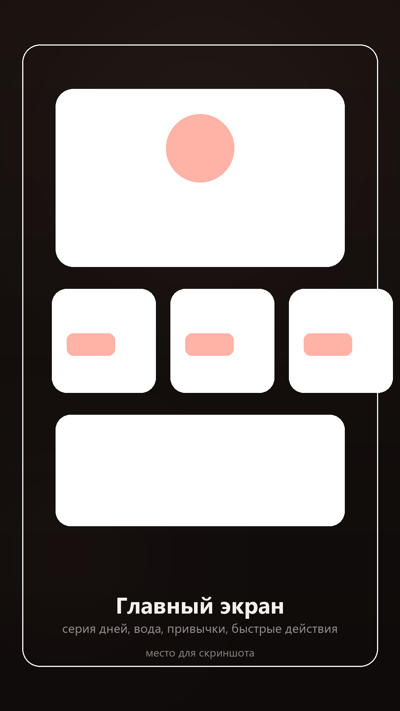
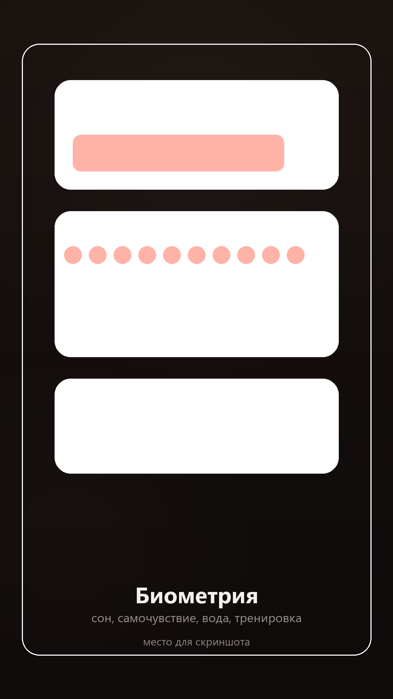
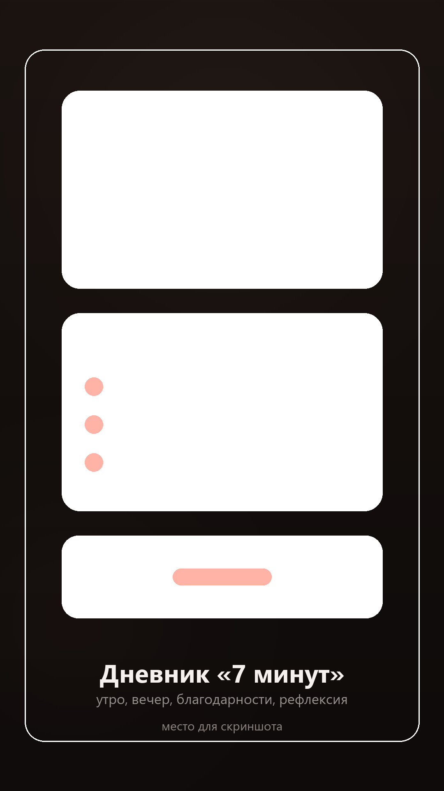
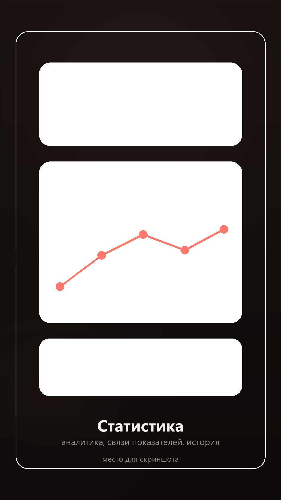
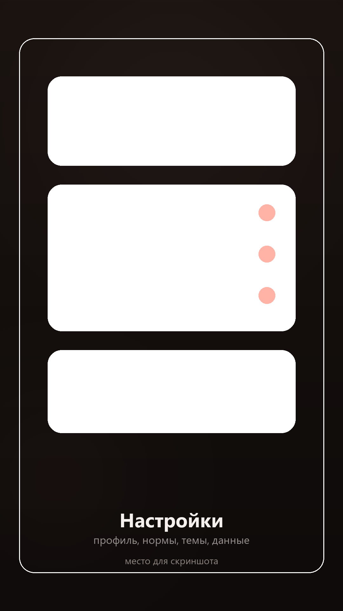

# 🧬 BioFlow — Ваш автономный биохакинг-трекер

  

**BioFlow** — это полностью локальный, приватный мобильный комбайн для мониторинга здоровья, ведения дневника осознанности и отслеживания привычек. Приложение создано для тех, кто хочет экономить силы и время на пути к лучшей версии себя, сохраняя 100% конфиденциальность личных данных.

---

## 📲 Скачать и установить

1. Откройте раздел **[Releases](https://github.com/Kir0029/BioFlow/releases/latest)** (Релизы).
2. Скачайте файл **`BioFlow_vX.Y.Z.apk`** — самый свежий релиз на странице.
3. Откройте скачанный файл на смартфоне Android.
4. Если система попросит разрешение на установку из внешних источников (из браузера, Telegram и т.п.) — разрешите.
5. Запустите приложение.

**Требования:** Android 7.0 и выше, ~70 МБ свободного места.

### ⚠️ Важно: переход с 1.1.4 на 1.1.5

Приложение переехало на новый ключ подписи, поэтому **1.1.5 не устанавливается поверх 1.1.4** — Android отклонит установку («конфликт подписей»). Обновление делается в три шага:

1. **Сохраните копию данных:** Настройки ➔ Данные ➔ *Экспорт копии (JSON)*.
2. **Удалите старую версию** приложения с телефона.
3. **Установите 1.1.5** и восстановите копию: Настройки ➔ Данные ➔ *Импорт копии (JSON)*.

Из старой копии восстановятся биометрия и дневник. Привычки придётся создать заново — в формате копии 1.1.4 их ещё не было.

> Начиная со следующих версий обновления будут устанавливаться поверх без удаления.

---

## ✨ Ключевые возможности приложения

* 📊 **Колесо жизненного баланса:** Оценивайте 9 сфер жизни и следите за балансом на радаре с читаемой легендой — полные названия сфер и оценка по каждой.
* 🧬 **Умный профиль:** Приложение само считает ваши персональные нормы сна и воды по возрасту, весу и уровню активности. Графики, подсказки, отчёты и связи между показателями считаются **по вашим** нормам, а не по усреднённым.
* 🛌 **Точный трекинг сна:** Записывайте время засыпания и пробуждения удобным круговым селектором.
* ⏱️ **Еженедельный спринт привычек:** До 15 привычек одновременно, с тактильным откликом. Забыли отметить день? Любой прошедший день текущей недели можно отметить задним числом.
* ⚡ **Быстрый лог воды:** Кнопка «+ Стакан» на главном экране — 250 мл в один тап, с мгновенной отменой действия.
* 💧 **Честные данные:** Пустое поле — это «не измеряли», а не ноль. Никаких фантомных значений в статистике и средних.
* 💡 **Локальные AI Insights (ИИ-Аналитика):** Автоматический анализ связей между сном, активностью, настроением и сферами жизни. Все расчёты выполняются на устройстве, результаты кэшируются для мгновенного доступа.
* 🏆 **Локальные достижения:** Закрывайте ежедневные цели и открывайте ачивки с праздничным салютом из конфетти.
* 📖 **Интерактивный дневник «7 минут»:** Утренние аффирмации, фокус дня, благодарности и глубокие вечерние рефлексии.
* ✍️ **Эмоциональный почерк и старение:** Итог дня меняет шрифт, размер и цвет текста под ваше настроение. Сильные эмоции оставляют след кофейной чашки, записи старше месяца получают текстуру старой бумаги, а старше трёх месяцев — оттенок сепии.
* 📅 **Лента времени и Память:** Единый фид вашей жизни: все события дня с редактированием в один клик. Раз в неделю на главном экране появляется интерактивная карточка рефлексии по событиям прошлого месяца.
* 🎓 **Обучение при первом запуске:** Короткий тур по главному экрану — что где лежит. Повторить его можно в любой момент: Настройки ➔ Информация ➔ *Показать обучение*.
* 💾 **Надёжная резервная копия:** Экспорт и импорт в JSON и CSV. Копия хранит привычки, эмоции, задачи, счётчики и id записей; копии старого формата тоже восстанавливаются.

---

## 📱 Скриншоты

<b>Нажмите, чтобы раскрыть скриншоты интерфейса</b>

 

| Главный экран | Биометрия | Дневник |
|:---:|:---:|:---:|
|  |  |  |

| Статистика | Настройки |  |
|:---:|:---:|:---:|
|  |  |  |

---

## 🛡️ Манифест конфиденциальности (Offline-First)

BioFlow не отправляет ваши данные на внешние серверы. Мы верим, что ваши мысли и показатели здоровья должны принадлежать только вам.

* 🔒 **Песочница данных:** Все данные хранятся на устройстве в изолированной локальной базе данных Isar.
* 🚫 **Никакой аналитики и рекламы:** В приложении нет трекеров (Firebase, Amplitude и др.), рекламных сетей и скрытого сбора статистики.
* 📴 **Работает без сети:** Приложение полностью функционально в авиарежиме — все расчёты, включая ИИ-аналитику, выполняются на устройстве.
* 🌐 **Единственный сетевой запрос:** Запрос выполняется **только по вашей кнопке** «Проверить обновления» в настройках: приложение спрашивает у GitHub номер последней версии. Больше никаких обращений в сеть не происходит.
* 🔄 **Полный контроль:** Экспортируйте базу в JSON/CSV для личного архива или очистите историю за конкретный год — вместе с привычками.

Подробности — в [Политике конфиденциальности](privacy_policy.md).

---

## 🔄 Система обновлений

* ⚙️ **Умная ручная проверка:** В любой момент откройте **Настройки ➔ Проверить обновления**. Приложение сделает один запрос к GitHub и, если вышла новая версия, покажет прямо внутри приложения список изменений и ссылку на скачивание. Никаких фоновых проверок без вашего ведома.
* 📋 **Экран «Что нового»:** После установки новой версии при первом запуске на главном экране появится диалог со списком улучшений.

---

## 📄 Документы и связь

* 📄 [Политика конфиденциальности](privacy_policy.md)
* ⚖️ [Лицензия](LICENSE) — исходный код закрыт, копирование и переиспользование не разрешены.
* 💬 Вопросы и предложения: Telegram [@kir029](https://t.me/kir029)

---

BioFlow — ваши данные остаются вашими.

